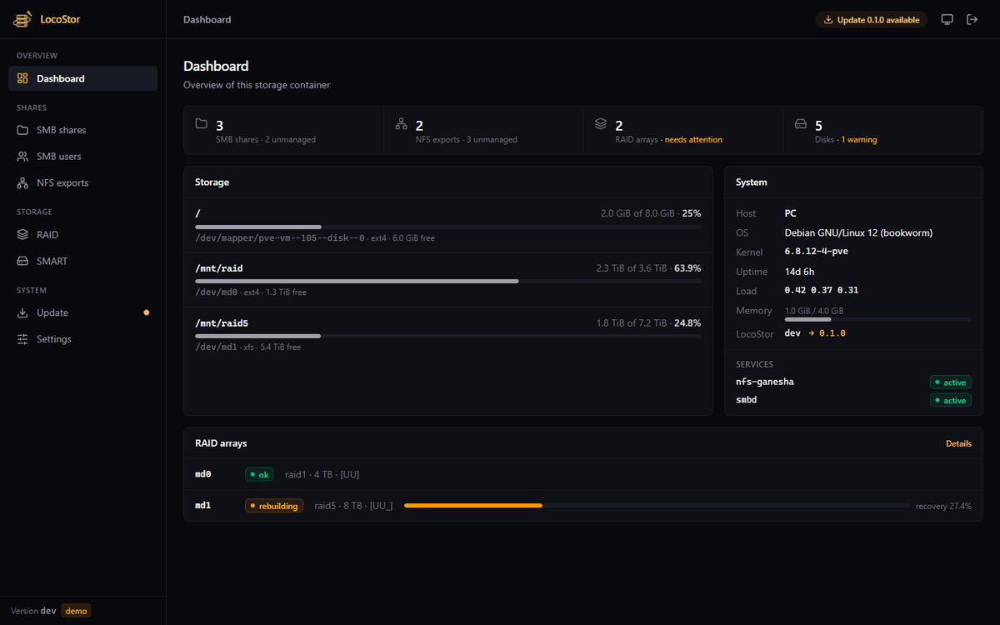

<p align="center">
  
</p>

<p align="center">
  Storage management for a Proxmox VE container – SMB, NFS, RAID and SMART in one small web UI.
</p>



## Features

- **SMB shares** – create, edit and remove Samba shares; per user and group *read & write*, *read only* or *denied*; folder permissions are fixed automatically so shares are never stuck read only
- **SMB users** – add, enable/disable, repair, change password and **test the login** like a Windows PC
- **Network name** – choose the server name and workgroup; the container's Samba only shows up in the network while it actually shares something
- **NFS exports** – manage NFS-Ganesha exports (NFSv3/v4, client lists, squash)
- **Shares of the Proxmox host** – the host's own SMB shares, Samba users and NFS exports are shown and can be edited; changes are made in place, so the host stays in charge and manual edits keep working
- **Existing shares in the container** – shares from `smb.conf`, `ganesha.conf` and `/etc/exports` are detected and can be taken over
- **RAID status** – read-only view of the host's mdadm arrays incl. rebuild progress
- **SMART** – disk health via `smartctl`, USB disks via `-d sat`, sleeping disks are not woken up
- **Patch automation** – daily updates of LocoStor, the container's packages and (optionally) the Proxmox host, with a **live terminal** in the web UI; SHA-256 verified self-update and rollback
- **Notifications** – RAID, SMART, temperature, free space and updates by **e-mail** (assistant with *Sign in with Microsoft/Google*, presets for WEB.DE, GMX, Telekom, …) or **Telegram** (@BotFather bot, connected with one link)
- **Active Directory / LDAP** – domain accounts and groups for the shares
- **Secure login** – username + password, **passkeys**, optional two-factor login (TOTP) with recovery codes
- **HTTPS** – built in, via Caddy or Nginx Proxy Manager, or behind your own reverse proxy – chosen during install
- Dark mode, responsive layout, single binary without dependencies

LocoStor writes its shares to `/etc/samba/locostor.conf` and
`/etc/ganesha/locostor.conf`, which are included from the main configs.
Everything else in those files stays as it is.

## Installation

Create a **privileged** Debian container in Proxmox – no further setup
needed. Then run this on the Proxmox **host** shell:

```sh
curl -fsSL https://raw.githubusercontent.com/Phydran6/LocoStor/main/scripts/install.sh | sh
```

The installer asks for the container ID and how the web UI should be reached
(HTTP or one of the HTTPS options below), mounts the RAID, passes the disks
through for SMART, installs LocoStor in the container and asks for the admin
username and password. It prints the address to open at the end.

Details, manual setup and troubleshooting: **[docs/proxmox.md](docs/proxmox.md)**.
Run inside a container, the same command installs LocoStor only there.

## Shares on the Proxmox host

When the installer runs on the host, it also sets up the **host agent**
(`locostor-host.service`). It lets the web UI show and edit the host's own
Samba shares and users and kernel NFS exports – the *Proxmox host* tab on the
share pages.

- The host stays the owner: LocoStor rewrites only the affected `[section]`
  of `smb.conf` or the one line of `/etc/exports`. Comments, global settings
  and everything else are left alone, and manual edits keep working.
- Each change is checked first (`testparm`, `exportfs -ra`), a backup is
  written (`<file>.locostor-<date>`, the last five are kept) and the change is
  rolled back if the service rejects it.
- The agent listens only on a Unix socket in `/var/lib/locostor-host`, which
  is bind-mounted into the container. It is not reachable over the network and
  applies the same checks as LocoStor itself (no system directories, no
  smb.conf options that run commands).

## Share permissions

Every share has a default for *all SMB users* (read & write, read only or
no access), exceptions per user or `@group` (read & write, read only,
denied) and a setting for guests. LocoStor writes the matching
`read only`, `valid users`, `read list`, `write list` and `invalid users`.

Samba can only allow what the Linux permissions of the folder allow – a
folder owned by `root` with mode `755` stays read only for everybody. With
**Fix folder permissions** (default for new shares) LocoStor gives the group
`locostor` read/write rights on the folder via POSIX ACLs (new files inherit
them) and lets Samba sessions use that group (`force group`). Owners and
other permissions stay as they are. The shield button on a share runs it
again, e.g. after copying files in on the host.

## In the network

*SMB shares → In the network* sets the server name (`\\NAS2`), workgroup
and description, separately for the container and the Proxmox host. With
**Automatic** (default in the container) the server only announces itself
while it shares something – a container without shares stops Samba and does
not appear as a second server next to the host. Windows 10/11 find servers
via WS-Discovery; `wsdd` is installed and announces the Samba name.

## Automatic updates

*Update → Automatic updates* runs every day (default 03:30):

| Part | Default | Options |
| --- | --- | --- |
| LocoStor releases | install | install, notify, off |
| Container packages | all updates | all, security only, notify, off |
| Proxmox host packages | check and notify | all (`dist-upgrade`), security only, notify, off |

The host agent is updated together with LocoStor. Every run – and *Update
now* – shows its output live in a terminal and is kept in the task log.
Shares keep running; Samba restarts briefly when it gets an update.

On GitHub, Dependabot proposes dependency updates daily and they are merged
when CI passes. A daily job checks the latest release binary with
`govulncheck`; when Go or a module has a security fix, it builds a patch
release automatically, which installations then pick up the next night.

## Notifications

*Integrations → Notifications*:

- **E-mail** – enter the address, the assistant detects the provider. Microsoft
  365/Outlook.com and Google use *Sign in with …* (OAuth, no password stored);
  WEB.DE, GMX, Telekom, IONOS, STRATO, iCloud, Yahoo, Posteo, mailbox.org and
  any other SMTP server work with (app) passwords.
- **Telegram** – create a bot with [@BotFather](https://t.me/BotFather), paste
  the token, open the link (or scan the QR code) and press *Start*.

For one-click Microsoft/Google sign-in without an own app registration, set
the repository variables `LOCOSTOR_MS_CLIENT_ID`, `LOCOSTOR_GOOGLE_CLIENT_ID`
and the secret `LOCOSTOR_GOOGLE_CLIENT_SECRET`; the release workflow builds
them in. Otherwise the assistant explains how to register an app (5 minutes).

## Passkeys

*Settings → Passkeys* adds Face ID, Touch ID, Windows Hello, a phone or a
security key. Browsers only allow passkeys on **HTTPS with a trusted
certificate and a host name** (not an IP address), e.g. via Caddy or Nginx
Proxy Manager with a domain.

## Active Directory / LDAP

*Integrations → AD / LDAP* joins the container to an Active Directory domain
(winbind; the container's DNS server must be the domain controller) or
connects it to OpenLDAP with the Samba schema. Domain users and groups such
as `@"domain users"` can then be used on the shares.

## HTTPS

During installation you choose how the web UI is reached. The question
continues with option 1 after 10 seconds; when you run the installer again,
the default is to keep the current setting.

| Option | What happens |
| --- | --- |
| 1 – HTTP on port 8080 | For a reverse proxy elsewhere, e.g. Nginx Proxy Manager in another VM. |
| 2 – HTTPS, self-signed | LocoStor serves HTTPS on 443 with its own certificate; ports 80 and 8080 redirect. |
| 3 – HTTPS, own certificate | Same, with certificate and key files you provide. |
| 4 – Caddy | Caddy in the container: Let's Encrypt for a public domain, else its local CA. LocoStor only listens on localhost. |
| 5 – Nginx Proxy Manager | NPM in Docker in the container (admin UI on port 81); nesting is enabled automatically. |

You can switch later without the installer:

```sh
locostor tls self-signed          # HTTPS on :443 with a new self-signed certificate
locostor tls files CERT KEY       # HTTPS with your own certificate
locostor tls off                  # plain HTTP on :8080
systemctl restart locostor
```

Behind a reverse proxy, forward `X-Forwarded-Proto` and `Host` so session
cookies are marked secure and the same-origin check passes (Nginx Proxy
Manager does this by default).

## Security

- Passkeys (WebAuthn) as password-less, phishing-proof login.
- Username + password (bcrypt), optional **two-factor login** with an
  authenticator app (TOTP, RFC 6238) and ten single-use recovery codes
  (stored hashed). Set it up under *Settings*.
- Failed logins are throttled per client and globally; sessions are random
  256-bit tokens, stored only as hashes, `HttpOnly` + `SameSite=Strict`.
- Every state-changing API call must be a same-origin JSON request (CSRF
  protection); strict Content-Security-Policy and security headers.
- Shares cannot point at system directories (`/`, `/etc`, `/root`, …), and
  smb.conf options that run commands (`preexec`, `* command`, `* script`, …)
  are refused.
- All external programs are started without a shell; every value written to
  a config file is validated.
- Updates are verified against `SHA256SUMS` and checked to run before they
  replace the current binary.

Recovery from the console (inside the container):

```sh
locostor passwd [-user NAME]   # new password (and username)
locostor mfa-reset             # turn off two-factor login
```

See [SECURITY.md](SECURITY.md) for reporting vulnerabilities.

## Configuration

`/etc/locostor/config.json` (mode 0600, created on first start):

| Key | Default | Description |
| --- | --- | --- |
| `listen` | `:8080` | Listen address |
| `username` | `admin` | Admin username |
| `password_hash` | – | bcrypt hash, set with `locostor passwd` |
| `totp_secret`, `recovery_codes` | – | Two-factor login, managed in the UI |
| `tls_cert`, `tls_key` | – | Serve HTTPS with these files |
| `http_redirect` | – | Plain HTTP addresses that redirect to HTTPS |
| `update_repo` | `Phydran6/LocoStor` | GitHub repo for self-updates |
| `data_dir` | `/var/lib/locostor` | State files (shares, exports, sessions) |
| `smart_devices` | – | Fixed disk list, e.g. `[{"device": "/dev/sda", "type": "sat"}]` |

Commands:

```
locostor [-config FILE] [-listen ADDR]   start the server
locostor passwd [-user NAME]             set the admin password (and username)
locostor mfa-reset                       turn off two-factor login
locostor tls self-signed|files|off       switch HTTPS mode
locostor version                         print the version
locostor -demo                           run with fake data (login admin / demo)
```

## Updates and rollback

The **Update** page shows the installed and latest version with release
notes. *Install update* runs in the background and the page follows it live:
download progress, checksum check, test run of the new binary, install and
restart. The running binary is kept as `locostor.previous`; *Roll back*
swaps the two again. Shares are not interrupted – only the web UI restarts,
and you stay logged in.

## Development

Requirements: Go 1.26+, Node.js 22+.

```sh
cd web && npm ci && npm run build && cd ..
go run ./cmd/locostor -demo            # http://localhost:8080, login admin / demo
```

Demo mode works on any OS and never touches the system. For frontend work run
`npm run dev` in `web/` in parallel (proxies `/api` to port 8080).

```
cmd/locostor/     entry point, CLI
internal/api      REST API + static file serving
internal/smb      Samba shares and users
internal/nfs      NFS-Ganesha exports
internal/raid     /proc/mdstat parser
internal/smart    smartctl JSON parser
internal/update   GitHub Releases self-update
internal/maintenance  daily patch automation
internal/system   apt updates
internal/tasks    background tasks with live output
internal/notify   e-mail / Telegram notifications, RAID/SMART monitor
internal/directory  Active Directory / LDAP
internal/auth     login, passkeys, TOTP, sessions, throttling
internal/tlsutil  self-signed certificates
internal/demo     fake backends for -demo
web/              Svelte 5 + Tailwind 4 frontend (embedded from web/dist)
deploy/           systemd unit
scripts/          installer
```

## Releases

Versions follow [Semantic Versioning](https://semver.org). Pushing a tag
`vX.Y.Z` runs the release workflow, which builds `linux/amd64` and
`linux/arm64` binaries and publishes them with the matching section of
[CHANGELOG.md](CHANGELOG.md) as release notes. Without a local Git, use
*Actions → Release → Run workflow* on `main` with the tag (e.g. `v0.5.0`):
it creates the tag and the release.

```sh
git tag v0.5.0 && git push origin v0.5.0
```

## License

[MIT](LICENSE)
